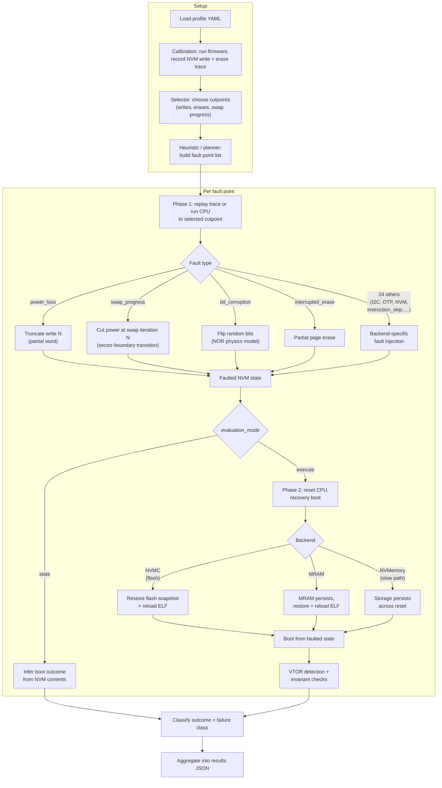

# How tardigrade works

The fault-injection model, the fault types, how points are chosen, and how results are judged. For the profile fields that control all of this, see [Writing profiles](writing-profiles.md).

## Fault injection model



1. **Trigger discovery** -- if the profile does not already seed a `pre_boot_state`, tardigrade can try a short trigger cascade (`no_trigger`, trailer magic, trailer metadata, offset placement) until calibration reaches real slot data movement. When bounded trace evidence is unavailable, discovery can instead accept an exact configured nonzero marker or independently derived target-image hash. That content must match the declared target, differ from the starting exec image, and accompany an explicit successful boot, current halted-state VTOR and PC values satisfying the declared slot constraints, satisfied runtime expectations, and positive flash activity. MCUboot profiles also get a compiled flash-map preflight: mismatches between the ELF's slot layout and the declared slots fail fast instead of looking "clean." Nonuniform or partially covered erase-sector geometry remains an advisory diagnostic for intentional geometry-specific profiles.
2. **Calibration** -- run the firmware once, count total NVM writes, capture the resulting boot evidence, and record write/erase traces when available.
3. **Cutpoint selection** -- choose candidate fault points from the clean trace or the available runtime counts. Trace-backed selection includes raw write indices, erase indices, semantic `swap_progress` boundaries, and security-state erase/restoration boundaries; trace-less runs omit selectors that cannot be derived safely.
4. **Heuristic pruning** -- classify write-indexed points by address into tiers, often reducing routine campaign size.
5. **Phase 1** -- replay the clean trace where supported, or execute the CPU to the selected cutpoint, then inject the fault. Trace replay eliminates O(N^2) prefix re-emulation for eligible power-loss points. What a cut leaves in the word being written is the backend's torn-word mode (`fault_sweep.mram_torn_word`); a profile can list several modes, optionally weighted, and each point then draws its own from a seeded generator keyed on the fault index, recording the drawn mode on the point (see [Per-cut torn-word outcomes](writing-profiles.md#per-cut-torn-word-outcomes)).
6. **Phase 2** -- `execute` mode resets the CPU and performs a full recovery boot from faulted NVM; `state` mode infers the outcome from NVM contents alone.
7. **Follow-up cycles / hooks** -- optional repeated boots and between-cycle hook actions model confirm-or-rollback flows and staged recovery.
8. **Classification** -- boot outcomes (`success`, `wrong_image`, `memory_checks_unmet`, `no_boot`, `wrong_pc`, `hard_fault`, `timeout`) and failure classes (`recoverable`, `wrong_image`, `memory_checks_unmet`, `silent_corruption`, `unrecoverable`). Recovery faults and liveness stalls take precedence over a simultaneous image mismatch, which remains supporting evidence. Fault exceptions (`IPSR` 3--6) and fault-handler vector entry classify as `hard_fault` by default on every boot cycle (including follow-up cycles and crashes after success checks hold); profiles whose firmware deliberately enters a fault handler after success checks hold (for example to write a crash report) must opt in with `success_criteria.allow_fault_after_success: true`, and uncorrectable NVM reads are never suppressed. Under `terminal_after_reset`, content mismatches remain terminal `wrong_image` immediately, while reachable `memory_checks` are polled across post-reset slices until they hold (`success`) or the budget ends with valid content and unmet checks (`memory_checks_unmet`, naming the failed checks). MRAM program faults retain exact address/width/byte telemetry plus an immediate snapshot and compact image diff. A `timeout` means an emulation, instruction, or wall-clock limit expired before a terminal result -- this is not counted as a failure.

## Fault types

28 fault types and semantic selectors are implemented across 8 backend
categories. Implemented means the planner and runtime accept the type. Fewer
types run against real upstream firmware; the coverage list follows the table.

| Category        | Fault types                                                                                                                                                                                    | Backend requirement                         |
| --------------- | ---------------------------------------------------------------------------------------------------------------------------------------------------------------------------------------------- | ------------------------------------------- |
| NVM write/erase | `power_loss`, `swap_progress`, `security_state_erase`, `bit_corruption`, `interrupted_erase`, `silent_write_failure`, `write_disturb`, `write_rejection`, `multi_sector_atomicity`, `wear_leveling_corruption` | Flash/MRAM capability-dependent             |
| NVM read/time   | `read_bit_flip`, `reset_at_time`, `timed_bit_corruption`                                                                                                                                       | NVMemory/MRAM for read faults; reset is all |
| NVM controller  | `command_drop`                                                                                                                                                                                 | GenericNvmController                        |
| NVM region      | `nvs_corruption`                                                                                                                                                                               | Declared NVS region                         |
| CPU glitch      | `instruction_skip`                                                                                                                                                                             | Arm execute mode                            |
| Driver error    | `driver_error`, `rc_injection`                                                                                                                                                                 | Instrumented driver / Arm execute mode      |
| I2C bus         | `i2c_nack`, `i2c_timeout`, `i2c_bit_flip`, `i2c_truncated`, `i2c_wrong_address`                                                                                                                | I2CFaultProxy                               |
| OTP fuse        | `otp_partial_program`, `otp_stuck_bit`, `otp_read_disturb`, `otp_overblow`, `otp_blow_nop`                                                                                                     | OTPMemory                                   |

Profile coverage by firmware provenance, counted from the effective
`fault_types` of every `profiles/*.yaml` and from the presets in
[`targets/nuttx_nxboot/generate_runtime_profile.py`](../targets/nuttx_nxboot/generate_runtime_profile.py)
and [`targets/tf_m_bl2/generate_runtime_profile.py`](../targets/tf_m_bl2/generate_runtime_profile.py).
Real upstream firmware means a bootloader ELF under
`results/oss_validation/assets/` or a generated NuttX nxboot or TF-M BL2 AN521 profile.

- Twelve types run in at least one profile against real upstream firmware and all twelve have recorded campaign reports:
  `power_loss`, `swap_progress`, `bit_corruption`, `interrupted_erase`,
  `silent_write_failure`, `write_disturb`, `write_rejection`,
  `multi_sector_atomicity`, `wear_leveling_corruption`, `instruction_skip`,
  `driver_error`, and `rc_injection`. MCUboot profiles cover and have recorded runs for all twelve. The
  NuttX generator presets cover `power_loss`, `swap_progress`, and
  `interrupted_erase`, the NuttX multi-fault canary also passes
  `bit_corruption` and `instruction_skip` to the generator, and the TF-M BL2
  AN521 generator presets cover `power_loss`.
- Seven types run only against synthetic firmware under `examples/`:
  `reset_at_time`, `command_drop`, `otp_partial_program`, `otp_stuck_bit`,
  `otp_read_disturb`, `otp_blow_nop`, and `nvs_corruption`. The last one
  appears only in `examples/nvs_config_migration/profile.yaml`.
- Nine types appear in no profile and are exercised only by the pytest suites
  under `tests/`: `security_state_erase`, `read_bit_flip`,
  `timed_bit_corruption`, `otp_overblow`, and all five `i2c_*` types.

See [`docs/mcuboot-fault-type-coverage.md`](mcuboot-fault-type-coverage.md) for the recorded fault-type execution inventory and point-level outcomes across real upstream MCUboot profiles.

Faults can be injected at different lifecycle stages: during the initial update write path, during pre-boot metadata/setup writes (`metadata_fault`), during between-boot confirm/accept hooks (`hook_fault`), during the recovery write path itself (`phase2_fault`), or as compound sequences (`multi_fault`), where each stage runs as the fault type of the single-fault result that selected it. The optional `durability_model: writeback` currently supports ordinary trace-reconstructable write paths. Lifecycle/compound and erase-atomicity combinations are rejected as incomplete until their persisted-state provenance can be reconstructed safely.

`swap_progress` uses calibration erase data to find real sector-boundary transitions in slot traffic, then reuses the normal power-cut replay path at those boundaries. On platforms where an erase trace is unavailable, tardigrade falls back to uniform `memory.page_size` buckets, which is usable on uniform flash and only approximate on non-uniform layouts. `security_state_erase` is also a semantic power-loss selector; it targets erase and restoration boundaries for declared persistent security fields.

Clean verdicts are coverage-gated. If calibration shows trailer-only activity, flash traffic outside the declared slots, or no NVM activity at all, tardigrade reports that as a failed/inconclusive setup instead of a clean `PASS`.

Trigger discovery is coverage-gated too. A strategy normally "wins" when calibration reaches slot data movement. If no bounded NVM trace is available, an exact target-content observation may select the trigger under the stricter checks described above; trace-dependent semantic points such as swap-progress boundaries remain unavailable. Trailer-only writes mean the bootloader noticed the trigger but rejected the image; zero writes mean the update path never ran. If every strategy fails, tardigrade returns `INCONCLUSIVE -- could not trigger firmware update` instead of pretending the bootloader is clean.

## Run modes

| Mode       | Selection                                       | Typical points      | Use case               |
| ---------- | ----------------------------------------------- | ------------------- | ---------------------- |
| Quick      | CLI `--quick`                                   | Up to 3 per enabled family by default | smoke only |
| Heuristic  | profile `fault_sweep.sweep_strategy: heuristic`  | target-specific     | normal CI / canary     |
| Exhaustive | profile `fault_sweep.sweep_strategy: exhaustive` | every planned point | deep manual validation |

By default, `--quick` selects the first, middle, and last point independently
for each enabled fault family or selector, so mixed campaigns can run more than
three points. With `quick_use_heuristic: true`, write-indexed faults use the
heuristic-selected set and the ordinary three-point reductions are not applied
to other enabled families. Add `--workers N` for parallelism. Build the public
validation container with
`docker build -f docker/oss-validation.Dockerfile -t tardigrade-oss-validation .`,
then use `--renode-test docker://tardigrade-oss-validation`.

The experimental MCUboot bulk-write state evaluator is disabled for CLI
audits by default because it predicts recovery from reconstructed flash state.
Use `--allow-mcuboot-state-evaluator` only for explicitly reviewed campaigns;
direct Python API callers may still opt in with `allow_state_evaluator=True`.

## Trace replay engine

Naive fault injection re-emulates the entire firmware prefix for each fault
point, producing O(N^2) total emulation for N points. For supported power-loss
campaigns, Tardigrade records a write trace during calibration and replays the
prefix instead of re-emulating Phase 1. The target and host determine the
resulting runtime savings.

Width-bearing rows record `write_index`, `flash_offset`, `value`, and `width`
(`1`, `2`, `4`, or `8` bytes). This preserves the access granularity needed for
byte-exact writeback reconstruction; traces without a width are accepted only
when the backend separately declares their fixed archived width.

## Write-address heuristic

Not all NVM writes are equally interesting. The heuristic classifier
(`scripts/write_trace_heuristic.py`) analyzes write addresses and groups them
into tiers: trailer metadata (exhaustive coverage), slot boundaries (dense
sampling), and bulk data copies (sparse sampling). This concentrates routine
campaigns on writes more likely to expose state-machine corruption; the actual
reduction is target-dependent.

## Semantic assertions beyond boot/no-boot

A device that boots to the wrong slot, confirms a corrupt image, or gets stuck in a revert loop is not "working." Tardigrade's state probes, semantic assertions, and composable invariant providers catch state-correctness bugs that pass a naive boot check. MCUboot PR #2199 is an example: the device boots, but its primary trailer stays in the REVERT state on every boot. The state probe catches it on the unfaulted control boot.

Instruction-skip sweeps can also attach verification bypass probes that record per-function return values instead of relying only on the final boot outcome. This lets tardigrade separate noisy CPU crashes from defense-in-depth catches and true full verification bypasses, which cuts down the false positives that otherwise show up in glitch-style campaigns.
See [`docs/mcuboot-instruction-skip-results.md`](mcuboot-instruction-skip-results.md) for the exhaustive 100-branch MCUboot instruction-skip sweep results across all 12 profiles.

Execute-mode `rc_injection` rejects a selected write and forces a configured
return value when a named wrapper returns. General `function_return_probes`
capture first, last, or all calls; the `success_implies_effect` invariant then
checks that a successful API return produced its declared persistent effect.
Other built-ins enforce atomic state groups, monotonic fields, and
cross-component state relations. The `transaction_state_isolation` invariant
retains semantic observations across update-sequence reset phases and detects
security metadata reused by a later transaction. The `persistent_state_fail_closed` invariant
checks that a failed persistent-state read cannot be followed by a write or an
accepted, committed, or booted outcome; incomplete telemetry is an evaluation
error rather than a finding.

## Write-back durability model

Real storage stacks often buffer writes in RAM before committing to flash. A bootloader that assumes write-through durability can have latent bugs invisible to direct fault injection. The optional `durability_model: writeback` mode reconstructs the persisted Phase 2 snapshot from a bounded operation trace: writes remain pending until a configured barrier or capacity eviction commits them, and a power cut discards the rest. Phase 1 still observes the live write-through view, so the model evaluates recovery durability without claiming to reproduce same-boot stale reads. Ambiguous or unavailable trace evidence fails closed. Replay refuses a backend that explicitly declares `PerWriteAccurate=false`, because address-difference traces cannot establish operation ordering for durability reconstruction.

Diagnostic annotations include a barrier audit that detects missing flush barriers between update phases, per-fault dirty-domain state, and a `commit_ratio` metric that quantifies how much of the write stream is uncommitted at each fault point. The validated barrier diagnostic is preserved in calibration caches and reported as `calibration.barrier_audit`.

Current-head MCUboot writeback profiles cover both swap-scratch and swap-move across STM32F4 and nRF52840:
[`profiles/mcuboot_head_scratch_stm32f4_writeback.yaml`](../profiles/mcuboot_head_scratch_stm32f4_writeback.yaml),
[`profiles/mcuboot_head_scratch_nrf52_writeback.yaml`](../profiles/mcuboot_head_scratch_nrf52_writeback.yaml),
[`profiles/mcuboot_head_move_nrf52_writeback.yaml`](../profiles/mcuboot_head_move_nrf52_writeback.yaml), and
[`profiles/mcuboot_head_move_stm32f4_writeback.yaml`](../profiles/mcuboot_head_move_stm32f4_writeback.yaml).
Run any of them with the normal audit CLI after the current-head assets are available:

```bash
python3 scripts/audit_bootloader.py \
  --profile profiles/mcuboot_head_scratch_stm32f4_writeback.yaml \
  --renode-test /path/to/renode-test
```

For real NuttX nxboot artifacts, the runtime profile generator exposes the
`sector_boundary_writeback` campaign; see the command in
[`targets/nuttx_nxboot/README.md`](../targets/nuttx_nxboot/README.md).
See [`docs/mcuboot-writeback-triage.md`](mcuboot-writeback-triage.md) for the MCUboot write-back durability triage across STM32F4 and nRF52840 swap-scratch and swap-move profiles.

## Execute-mode hardening

In `execute` mode, Phase 2 performs a full CPU recovery boot from faulted NVM:

- **VTOR polling** detects which slot the bootloader jumped to.
- **5ms confirmation window + CFSR HardFault check** verifies boot stability.
- **Sticky fault signal** (`FaultEverFired`) survives subsequent writes and resets.
- **Write stabilization early-exit** reduces per-point runtime when writes settle.
- **No-boot introspection** emits partition post-mortem dumps and per-operation PC traces for `no_boot` outcomes.

## Performance

- **Trace replay** -- recorded prefixes replace repeated Phase 1 emulation where supported
- **Cached flash restore** -- single `WriteBytes` per fault point instead of per-page erase+load
- **Hash bypass** -- patches out crypto validation on faulted sweep runs via `sweep_hash_bypass_symbols`
- **Parallel workers** -- `--workers N` distributes fault points across N Renode instances
- **Heuristic pruning** -- address-aware tiers reduce routine point sets by a target-dependent amount
- **Interleaved distribution** -- round-robin assignment balances load across workers

Campaign time varies substantially with target, fault types, recovery cycles, and worker count; the bundled power-loss profiles are reference points, not a general runtime guarantee.

## Profile-driven architecture

Sweeps are profile-driven YAML -- describe the memory layout, slots, images, and success criteria. Advanced semantic checking (state probes, custom invariants, boot register capture, write-order constraints) requires small Python hooks. A `security_policy` block models anti-rollback floors, minimum version enforcement, and TOCTOU protection for adversarial fault scenarios. Optional `update_protocol`, `authorization_review`, `persistent_state_layout`, and `boundary_campaigns` blocks add declarative security-path analysis and campaign expansion.

Use `target_source` when a target artifact comes from another checkout so its explicitly supplied revision is retained in reports, including containerized runs. Use `expect.mode: exploratory` or `hunt` for campaigns that are intended to explore rather than require findings.

For upgrade-style profiles, the preferred starting point is minimal: ELF, slot layout, images, and success criteria. If you omit `pre_boot_state` and either omit `update_trigger` or set `update_trigger: auto`, tardigrade will try to discover the update trigger automatically before the real sweep. Set `success_criteria.allow_fault_after_success: true` (default `false`) only when firmware deliberately enters a fault handler after success checks hold; otherwise any active fault exception or fault-vector spin classifies as `hard_fault` on every boot cycle.

See **[`docs/writing-profiles.md`](writing-profiles.md)** for the complete profile-writing guide: field-by-field reference, platform selection, success criteria options, invariant configuration, and result interpretation.

## Report structure

The CLI report's top-level `verdict` is an expectation assertion and begins
with `PASS`, `FAIL`, or `INCONCLUSIVE`. A `PASS` can mean that a deliberately
vulnerable regression profile produced the expected findings. The separate
`security_aggregate.status` is `CLEAN`, `FINDINGS`, or `INCONCLUSIVE` across
runtime, multi-component, boundary, terminal-error, and authorization
evidence. The GitHub Action combines both values into its binary `verdict`
output and requires `CLEAN` unless `regression-mode` is explicitly enabled.

For runtime sweeps, `bricks` counts unrecoverable failures, `issue_points`
includes broader mismatches (wrong slot, unmet memory checks, semantic assertions, and invariant
violations), and `timeout_points` counts points where an emulation,
instruction, or wall-clock limit expired without a terminal result. Timeouts
are not failures; increase the relevant profile limit to resolve them. Common boot outcomes are `success`,
`wrong_image`, `memory_checks_unmet`, `no_boot`, `wrong_pc`, `hard_fault`, and `timeout`. Clean runtime
evidence also requires calibration coverage: if the bootloader never moves
slot data during calibration, tardigrade reports an incomplete setup rather
than claiming the bootloader is clean.

See **[`docs/writing-profiles.md`](writing-profiles.md)** for the full report JSON structure and how to interpret results.
